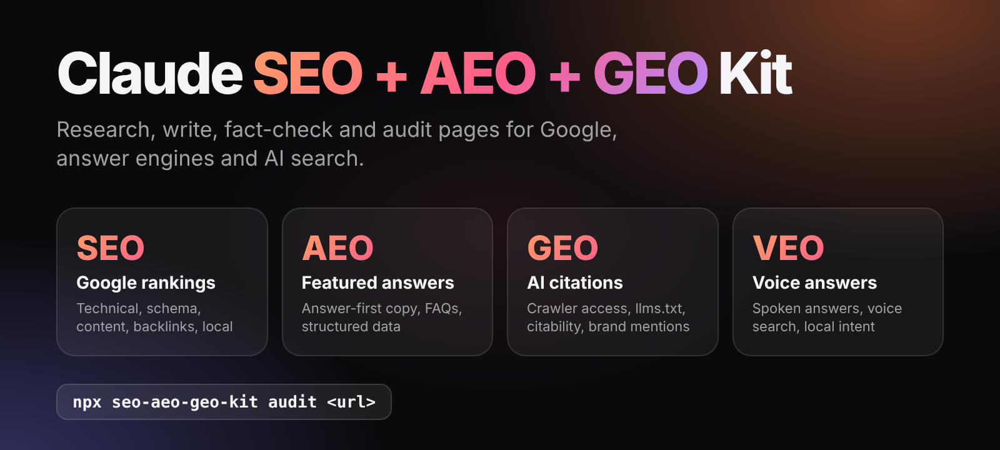
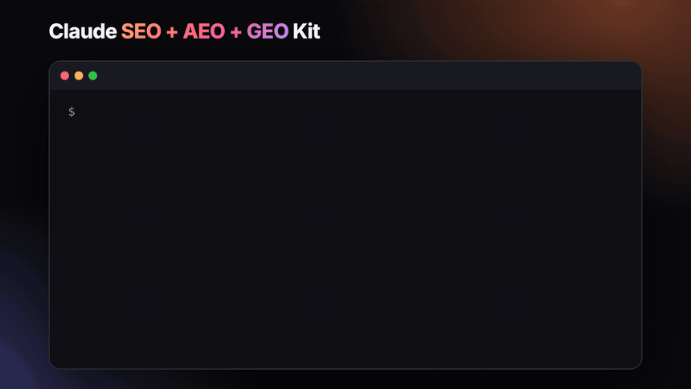
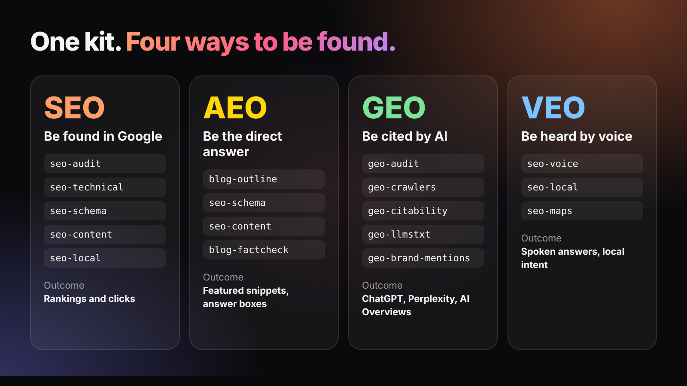
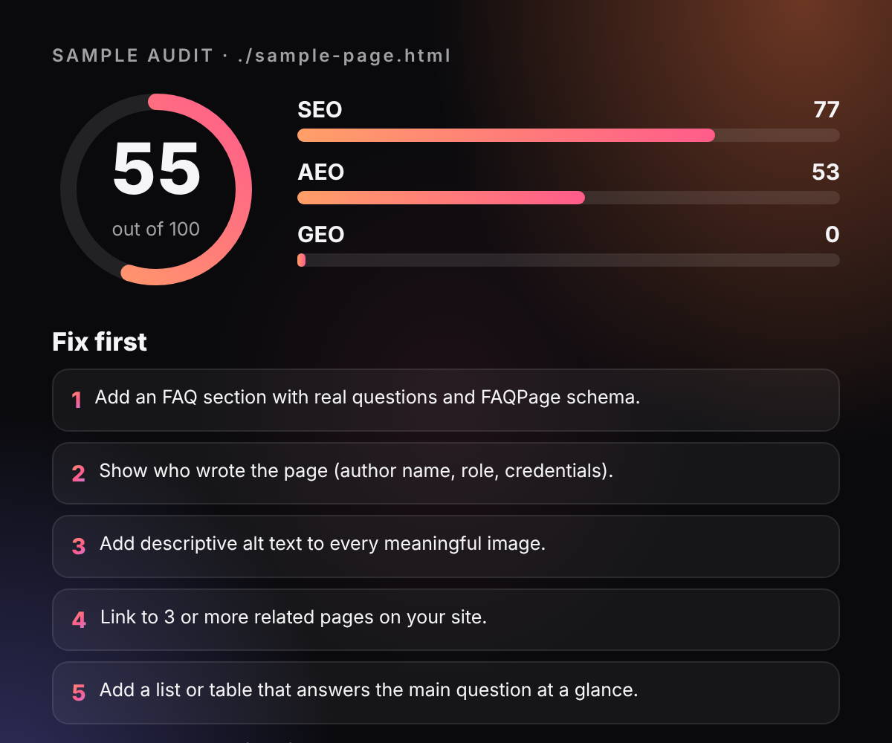
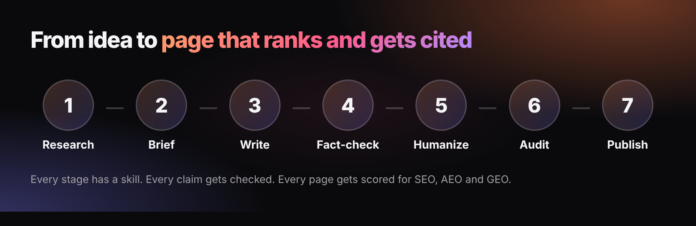

<p align="center"></p>

<h1 align="center">Claude SEO + AEO + GEO Kit</h1>

<p align="center"><b>82 skills that research, write, fact-check and audit pages for Google, answer engines and AI search.</b><br>Plus a free command that scores any page 0-100.</p>

<p align="center">
<a href="https://www.npmjs.com/package/seo-aeo-geo-kit"></a>
<a href="LICENSE"></a>


</p>

<p align="center"></p>

**Jump to:** [Quick start](#quick-start) · [What the auditor checks](#what-the-auditor-checks) · [How it fits together](#how-it-fits-together) · [FAQ](#faq) · [Credits](#credits)

| Pillar | What it covers |
| --- | --- |
| **SEO** | Site and page audits, technical SEO, schema, sitemaps, hreflang, E-E-A-T, backlinks, local and maps |
| **AEO** (answer engines) | Answer-first writing, FAQs, featured-snippet structure, structured data |
| **GEO** (AI search) | AI crawler access, `llms.txt`, citability, brand mentions, ChatGPT / Perplexity / AI Overviews tuning |
| **VEO** (voice) | Spoken answers, voice search, local intent |
| **Content and growth** | Blog production from brief to fact-check, plus CRO, offers, pricing and editorial polish |

<p align="center"></p>

## Quick start

### 1. Score any page in 10 seconds (no Claude needed)

```bash
npx seo-aeo-geo-kit audit https://your-site.com/page
```

You get a score out of 100 for SEO, AEO and GEO, a pass/fail list, and the top fixes. Add `--summary` for just the score and fixes.

<p align="center"></p> Works on local `.html` files too. Add `--json` for machine-readable output.

### 2. Use the skills in Claude Code (recommended)

```text
/plugin marketplace add alpit-patel/seo-aeo-geo-kit
/plugin install seo-aeo-geo-kit@seo-aeo-geo-kit
```

Then ask in plain language: "audit this page for SEO, AEO and GEO", "write a blog post on X and fact-check it", or "check whether AI crawlers can read my site".

### 3. Or copy just the skills you want

```bash
npx seo-aeo-geo-kit install --only seo,geo        # into ./.claude/skills
npx seo-aeo-geo-kit install --global              # into ~/.claude/skills
npx seo-aeo-geo-kit list --family GEO
```

`install` copies skill folders only. The plugin also includes the helper scripts.

## How it fits together

<p align="center"></p>

- [`system/routing.md`](system/routing.md): which skills run for which task, and in what order.
- [`system/quality-gates.md`](system/quality-gates.md): the checks a deliverable must pass.
- [`system/evidence-policy.md`](system/evidence-policy.md): no invented evidence, ever.
- [`system/skill-registry.json`](system/skill-registry.json): machine-readable index of every skill.
- [`templates/`](templates/): content brief, project context and QA report templates.
- [`scripts/`](scripts/): Python helpers for Search Console, GA4, autocomplete research and text cleanup. They read your own config files (see the `*.example.json` files).

## What the auditor checks

25 deterministic checks: title, meta description, headings, canonical, mobile, image alt text, internal links and Open Graph (SEO); JSON-LD, FAQ markup, answer-first opening, lists and question headings (AEO); AI-crawler access in `robots.txt`, `llms.txt`, author and date, external citations, facts and entity schema (GEO).

It reports what is **missing**. It does not predict rankings, and nothing replaces real content quality.

## FAQ

### What is GEO?
Generative Engine Optimization: making your content easy for AI systems such as ChatGPT, Perplexity and Google AI Overviews to find, understand and cite.

### What is AEO?
Answer Engine Optimization: structuring content so search features and assistants can lift a direct answer, such as featured snippets and voice answers.

### Does it guarantee rankings?
No. Nobody can. It gives you a repeatable process and a checklist.

### Do I need an API key?
No. The auditor and most skills need none. A few helper scripts use optional services (Google Search Console, GA4, DataForSEO). When a helper script is not bundled, the skills fall back to manual checks and say so.

### Is my data sent anywhere?
The auditor only fetches the URL you give it, plus that site's `robots.txt` and `llms.txt`. The skills run inside Claude Code under your own settings.

## Credits

This kit curates and connects work from several open-source authors, all under the MIT License, including AgriciDaniel, Zubair Trabzada, Corey Haines, Siqi Chen, Guillaume Meyer and puneetindersingh. See [`THIRD_PARTY_NOTICES.md`](THIRD_PARTY_NOTICES.md) for the full list. Each skill keeps its original license file.

## Contributing

See [`CONTRIBUTING.md`](CONTRIBUTING.md). Before a pull request: `npm test`, `npm run validate` and `claude plugin validate .`.

## License

MIT. See [`LICENSE`](LICENSE) and [`THIRD_PARTY_NOTICES.md`](THIRD_PARTY_NOTICES.md).
